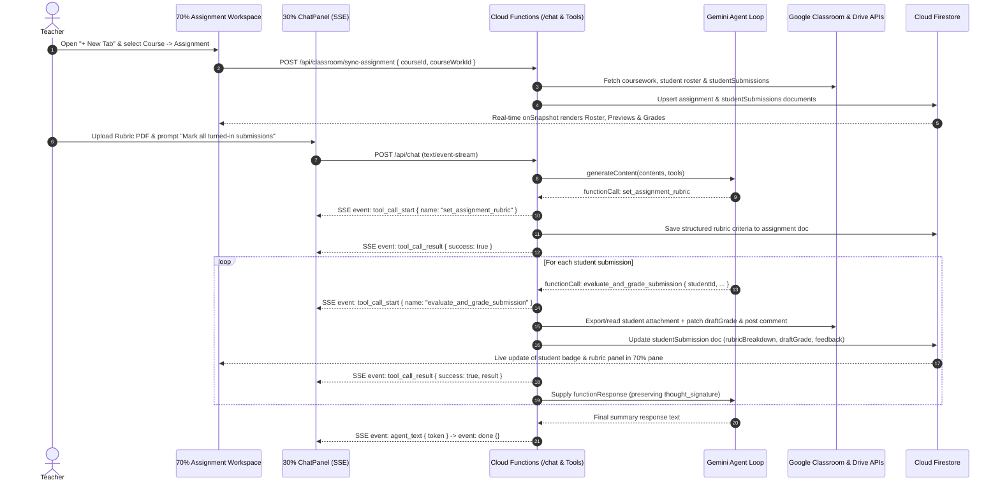

# Product Requirements Document (PRD): Classroom Agent

**Document Status:** Approved Architecture & Product Specification  
**Reference Blueprint:** [agent_pane_design_plan.md](file:///home/kieren/Documents/code/classroom-agent/agent_pane_design_plan.md)

---

## 1. Executive Summary & Product Vision

**Classroom Agent** is an AI-native grading and feedback workstation for educators using Google Classroom. It pairs a **70% multi-tabbed Assignment & Submission Workspace** on the left with a **30% persistent, streaming Agent Co-Pilot Pane** on the right.

Educators can open multiple Google Classroom assignments as persistent tabs, inspect every student's submission across diverse formats (Google Docs, Slides, Sheets, PDFs, images, code files, Markdown, short answers, and web links), define or upload marking rubrics via the chat co-pilot, and automate criterion-by-criterion marking and feedback generation. Grades (`draftGrade` / `assignedGrade`) and feedback comments are written directly to Google Classroom / Google Drive and mirrored in Cloud Firestore for real-time UI reactivity.

---

## 2. Core Architectural Principles

1. **70/30 Split Co-Pilot Architecture**:
   - **70% Left Pane**: Multi-tabbed assignment workspace featuring a 3-zone internal layout (Student Roster, Submission Preview Canvas, and Rubric Breakdown & Comments Panel).
   - **30% Right Pane**: Persistent streaming `ChatPanel` scoped per open assignment tab (`projectId = assignmentId`), adhering strictly to [agent_pane_design_plan.md](file:///home/kieren/Documents/code/classroom-agent/agent_pane_design_plan.md).
2. **Tab-Resilient In-Memory Sessions**:
   - Each opened assignment tab mounts both its 70% `AssignmentWorkspace` and its paired 30% `ChatPanel` inside a persistent DOM container toggled via CSS `flex` / `hidden`.
   - Switching between assignment tabs never unmounts active sessions: in-flight SSE grading streams, staged rubric file uploads, selected student state, and unsent prompt drafts survive tab navigation seamlessly.
3. **Direct Classroom API Write-Back + Dual-State Firestore Sync**:
   - Whenever the agent or teacher updates a student's rubric scores, grade, or feedback, the backend writes directly to the Google Classroom API (`draftGrade` by default, or `assignedGrade` + `return` when releasing marks) and posts feedback comments via Drive/Classroom APIs, while simultaneously persisting the full structured state to Cloud Firestore.
   - The 70% workspace listens to Firestore via `onSnapshot` so student rows, rubric breakdowns, and grade badges update in real time as each student is marked.
4. **Student-by-Student Tool Transparency**:
   - During automated batch marking, the agent emits an individual tool call (`evaluate_and_grade_submission`) per student rather than a single opaque bulk call. Each student's grading execution renders its own live collapsible `ToolCallBadge` in the 30% chat stream and immediately updates the 70% UI upon completion.
5. **Fail-Fast Engineering**:
   - No silent default fallbacks for missing environment variables, OAuth tokens, required parameters, or unauthenticated states.
   - No mock or dummy data in production code. Missing configuration or API permission errors surface immediately as explicit, actionable errors.

---

## 3. System Architecture & Tech Stack

| Layer | Technology | Responsibility |
| :--- | :--- | :--- |
| **Frontend SPA** | React 18+, Vite, TypeScript, Tailwind CSS, `lucide-react` | 70/30 split layout, tab manager, 3-zone assignment view, multi-format submission previewer, SSE stream consumer |
| **Authentication** | Firebase Auth (Google OAuth 2.0 Provider) | Teacher sign-in and OAuth 2.0 access/refresh token acquisition for Google Classroom & Google Drive scopes |
| **Backend API** | Firebase Cloud Functions (`\functions`, Node.js + Express + TypeScript) | `/chat` SSE streaming endpoint, Google Classroom/Drive proxy & sync endpoints, multimodal file extraction, direct Firestore mutations |
| **LLM Engine** | `@google/genai` (`gemini-3.8-flash` / `gemini-flash-latest`) | Multi-turn function-calling loop with verbatim `candidate.content` (`thought_signature`) preservation |
| **Database & Storage** | Cloud Firestore & Firebase Cloud Storage | Real-time state persistence for synced assignments, rubrics, student submission evaluations, and chat histories; Cloud Storage for uploaded mark schemes |

### 3.1 Required Google OAuth 2.0 Scopes

- `https://www.googleapis.com/auth/classroom.courses.readonly` — List teacher's courses.
- `https://www.googleapis.com/auth/classroom.coursework.students` — Read student submissions, patch `draftGrade` / `assignedGrade`, return submissions, and manage coursework.
- `https://www.googleapis.com/auth/classroom.rosters.readonly` — Fetch student profile names, emails, and avatars.
- `https://www.googleapis.com/auth/classroom.student-submissions.students.readonly` — Read student submission states and attachments.
- `https://www.googleapis.com/auth/drive.readonly` — Export and preview student-submitted Google Docs, Slides, Sheets, PDFs, images, and code files.
- `https://www.googleapis.com/auth/drive.file` — Post feedback comments onto student Drive files where applicable.



---

## 4. Detailed User Interface & Layout Specification

The application occupies a locked full-viewport dark container (`h-screen w-screen overflow-hidden bg-[#0d1117] text-gray-200`).

```
+--------------------------------------------------------------------------------------------------+
| [Logo] Classroom Agent   | [Tab 1: CS101 Essay x] [Tab 2: Lab 3 Python x] [+ New Assignment Tab] |
+-------------------------------------------------------------------+------------------------------+
| 70% LEFT PANE: ACTIVE ASSIGNMENT WORKSPACE                        | 30% RIGHT PANE: AGENT PANE   |
| +-------------------+-------------------------+-----------------+ | +--------------------------+ |
| | ZONE A:           | ZONE B:                 | ZONE C:         | | | Sparkles: GRADING AGENT  | |
| | STUDENT ROSTER    | SUBMISSION PREVIEW      | RUBRIC &        | | +--------------------------+ |
| | (22% of left)     | CANVAS (48% of left)    | MARKING (30%)   | | | User: Mark all turned-in | |
| |                   |                         |                 | | |                          | |
| | [Search/Filter]   | [Attachment Tabs:       | Total: 85 / 100 | | | Agent:                   | |
| | [Return Drafts]   |  essay.docx | code.py]  | [Save] [Return] | | | +----------------------+ | |
| |                   |                         |                 | | | | Tool: evaluate_and_  | | |
| | > Alice Smith     | +---------------------+ | Criterion 1:    | | | | grade_submission     | | |
| |   TURNED_IN 85/100| |                     | | Thesis (25/25)  | | | | [success] [Details v]| | |
| |                   | |   Document / PDF /  | | "Clear thesis"  | | | +----------------------+ | |
| |   Bob Jones       | |   Code / Image /    | |                 | | | +----------------------+ | |
| |   TURNED_IN --/100| |   Link / Text       | | Criterion 2:    | | | | Tool: evaluate_and_  | | |
| |                   | |   Preview           | | Evidence (30/40)| | | | grade_submission     | | |
| |   Charlie Kim     | |                     | | "Needs citation"| | | | [executing...]       | | |
| |   RETURNED  92/100| +---------------------+ |                 | | | +----------------------+ | |
| |                   |                         | Overall Comment:| | +--------------------------+ |
| |   Dana Lee        |                         | [Strong essay..]| | | [Status Ticker...]       | |
| |   MISSING   --/100|                         | [Comment History| | | [Clip] [Command...] [>>] | |
| +-------------------+-------------------------+-----------------+ | +--------------------------+ |
+-------------------------------------------------------------------+------------------------------+
```

### 4.1 Top Tab Bar & Assignment Selector (`+ New Tab`)

1. **Tab Bar (`data-testid="assignment-tab-bar"`)**:
   - Displays all currently opened assignment tabs, showing Course Name badge, Assignment Title, and a close (`×`) button.
   - Includes a `+` button (`data-testid="new-assignment-tab-button"`) to open the Assignment Selector.
   - Switching tabs toggles CSS visibility (`flex` vs `hidden`) on the per-tab wrapper containing both the 70% `AssignmentWorkspace` and the 30% `ChatPanel`.
2. **New Tab / Assignment Picker View (`data-testid="assignment-picker-view"`)**:
   - Fetches active courses from Google Classroom (`GET /api/classroom/courses`).
   - Selecting a course loads its coursework/assignments (`GET /api/classroom/courses/:courseId/coursework`), displaying:
     - Assignment title, description preview, due date, `maxPoints`, and submission counts (`Turned In`, `Graded`, `Missing`).
     - API Write-Back Readiness badge (indicating whether the coursework is associated with the developer project for direct grade patching, plus a **"Clone / Create in Classroom Agent"** action if needed).
   - Clicking an assignment syncs its roster and submissions into Firestore and switches the tab into the 3-Zone Assignment Workspace.

### 4.2 70% Left Pane: 3-Zone Assignment Workspace

#### Zone A: Student Roster Column (`w-[22%] border-r border-[#30363d] bg-[#161b22]`)
- **Assignment Summary Header**:
  - Course name, assignment title, maximum points (e.g., `100 pts`), and a manual **Refresh from Classroom** button (`data-testid="sync-classroom-button"`).
  - **Bulk Action Button (`data-testid="return-all-drafts-button"`)**: *"Return All Draft Grades (N)"* — promotes all staged `draftGrade` scores to `assignedGrade` and executes `studentSubmissions.return` on Google Classroom.
- **Filter & Search Bar**:
  - Text search input (`data-testid="student-search-input"`) by student name or email.
  - Filter pills (`data-testid="student-filter-pills"`): `All`, `Turned In`, `Unmarked`, `Draft`, `Returned`, `Missing`.
- **Student List (`data-testid="student-roster-list"`)**:
  - Each row (`data-testid="student-row-{studentId}"`) displays:
    - Student avatar & full name.
    - Submission state badge:
      - `TURNED_IN` (blue)
      - `DRAFT_GRADED` (purple — `draftGrade` set, not yet returned)
      - `RETURNED` (emerald — `assignedGrade` returned to student)
      - `MISSING` / `CREATED` (gray/amber)
      - `LATE` indicator pill if `submission.late === true`
    - Score pill: e.g., `85 / 100` or `-- / 100`.

#### Zone B: Submission Preview Canvas (`w-[48%] border-r border-[#30363d] bg-[#0d1117]`)
- **Attachment Switcher Header (`data-testid="attachment-switcher"`)**:
  - When a student submission contains multiple attachments, displays horizontal tabs for each item with file-type icons and an **"Open in Google Drive / Classroom"** external link button.
- **Multi-Format Preview Renderer (`data-testid="submission-preview-container"`)**:
  - **Google Drive Docs, Slides, and Sheets**:
    - Renders an embedded PDF/HTML preview exported via the backend (`/api/classroom/drive-preview/:fileId`) alongside an extracted plain-text / table view toggle so the teacher can inspect the exact content the LLM reads.
  - **PDFs & Images**:
    - Native embedded PDF viewer (`<iframe />` / object viewer) and zoomable image preview for `.png`, `.jpg`, `.webp`, `.gif`.
  - **Code Files, Plain Text, and Markdown**:
    - Syntax-highlighted code viewer with line numbers for source code files (`.py`, `.js`, `.ts`, `.java`, `.cpp`, `.html`, `.css`, `.json`, etc.) and formatted Markdown preview with a raw source toggle.
  - **Short-Answer Responses & External Links**:
    - Renders `shortAnswerSubmission.answer` in a clean typography card, and renders `link` attachments with title, thumbnail/favicon, URL, and extracted page text preview.
  - **Empty State**:
    - Clear indicator if the selected student has not attached any work or if no student is selected.

#### Zone C: Rubric Breakdown, Marking & Comments Panel (`w-[30%] bg-[#161b22]`)
- **Grade Header & Classroom Sync Bar (`data-testid="grading-header"`)**:
  - Displays Total Score input (`data-testid="total-grade-input"`) out of `maxPoints` (automatically summed from rubric criteria when a rubric is active, or manually editable).
  - Sync Status Pill (`data-testid="classroom-sync-status"`): `Draft Saved to Classroom`, `Returned to Student`, `Unsaved Changes`, or `Sync Error`.
  - Action Buttons:
    - **Save Draft (`data-testid="save-draft-grade-button"`)**: Immediately patches `draftGrade` and syncs feedback comments to Google Classroom / Drive and Firestore.
    - **Return to Student (`data-testid="return-submission-button"`)**: Sets `assignedGrade`, calls `studentSubmissions.return`, and marks the submission as `RETURNED`.
- **Rubric Criteria Breakdown (`data-testid="rubric-breakdown-list"`)**:
  - If a rubric is configured for the assignment, renders each criterion card (`data-testid="rubric-criterion-{criterionId}"`):
    - Criterion title, description, and point allocation (`score` input out of `maxPoints`).
    - Criterion-specific feedback / justification text area (populated by the agent or editable by the teacher).
  - Includes an **"Edit Rubric"** toggle (`data-testid="edit-rubric-button"`) allowing manual inspection or quick prompt shortcut to the agent.
- **Overall Summary Feedback & Comments (`data-testid="overall-feedback-section"`)**:
  - Editable **Overall Summary Feedback** textarea (`data-testid="overall-feedback-input"`), populated automatically by the agent during grading or edited by the teacher.
  - **Comments Feed (`data-testid="submission-comments-list"`)**: Displays synced feedback comments (with timestamp, author badge `Agent` / `Teacher`, and sync status to Google Drive / Classroom).

### 4.3 30% Right Pane: Persistent Agent Co-Pilot (`ChatPanel`)

Follows the exact visual tokens, component structure (`ChatPanel.tsx`, `ToolCallBadge.tsx`, `api.ts`), and dual-state reconciliation rules defined in [agent_pane_design_plan.md](file:///home/kieren/Documents/code/classroom-agent/agent_pane_design_plan.md):
- **Context Isolation**: Each open assignment tab instantiates `<ChatPanel projectId={assignmentId} ... />`.
- **Selected Student Context**: Passes the currently selected `studentId` as `contextId` in `ChatRequestBody` so commands like *"Mark this student's submission"* or *"Give stricter feedback on criterion 2"* automatically target the active student in Zone B/C.
- **Multimodal Mark Scheme Upload**: Teachers can attach a `.pdf`, `.txt`, `.md`, `.json`, `.csv`, `.doc`, or `.docx` rubric/mark scheme via the paperclip button. The file is uploaded to Firebase Cloud Storage (`gs://...`) and passed via `fileUri` and `fileMimeType` to `/api/chat`.
- **Default Prompt Starters**:
  1. `"Generate a grading rubric based on the assignment instructions"`
  2. `"Evaluate and grade the currently selected student's submission"`
  3. `"Mark all turned-in ungraded submissions using the rubric"`
  4. `"Summarize class performance and common mistakes across all graded submissions"`

---

## 5. Backend Agent Loop & Tool Specification

### 5.1 Agent Loop Configuration (`POST /api/chat`)

- Uses `@google/genai` with `gemini-3.8-flash` (or `gemini-flash-latest`).
- **Thought Signature Rule**: Every model turn `candidate.content` is pushed verbatim into `contents` before appending `{ role: 'tool', parts: responseParts }`.
- **Multi-Turn Iteration Limit**: `MAX_TURNS = 40` to support class-sized sequential or batched per-student `evaluate_and_grade_submission` tool calls within a single user request.
- **System Instruction**: Injects the current assignment metadata (Course Name, Assignment Title, Description, `maxPoints`, active Rubric JSON, and currently selected `studentId`) into the system prompt so the agent has immediate grounding.

### 5.2 Agent Tool Declarations

| Tool Name | Parameters | Execution Behavior & Side Effects |
| :--- | :--- | :--- |
| `get_assignment_details` | `{}` | Returns assignment description, `maxPoints`, due date, active rubric criteria, and submission statistics from Firestore. |
| `set_assignment_rubric` | `{ criteria: Array<{ id: string, title: string, description: string, maxPoints: number }> }` | Validates that criterion points sum to `assignment.maxPoints` (or scales/warns), saves the rubric to `assignments/{assignmentId}` in Firestore, and updates Zone C in real time. |
| `list_student_submissions` | `{ statusFilter?: 'ALL' \| 'TURNED_IN' \| 'UNGRADED' \| 'DRAFT_GRADED' \| 'RETURNED' \| 'MISSING' }` | Returns the list of students in the assignment with their `studentId`, `studentName`, `submissionId`, `state`, `late`, `draftGrade`, `assignedGrade`, and attachment metadata. |
| `get_student_submission_content` | `{ studentId: string }` | Downloads/exports the student's Drive attachments (Docs/Slides/Sheets -> text/PDF, code/text -> string, PDF/image -> inline/file data) and returns the extracted content + metadata so the agent can inspect it thoroughly. |
| `evaluate_and_grade_submission` | `{ studentId: string, rubricScores: Array<{ criterionId: string, score: number, comment: string }>, draftGrade: number, overallFeedback: string }` | **Invoked once per student** (even in batch runs). Calculates/validates score, calls Google Classroom `studentSubmissions.patch` (`draftGrade`), posts the formatted rubric + overall feedback comment to the student's submission/Drive file, and persists the full evaluation to Firestore. |
| `return_student_submissions` | `{ studentIds: string[] }` | Promotes `draftGrade` to `assignedGrade` via `studentSubmissions.patch` and calls `studentSubmissions.return` on Google Classroom for the specified students, updating Firestore state to `RETURNED`. |

---

## 6. Google Classroom & Drive API Integration Details

### 6.1 Handling Google Classroom API Write-Back Rules
Google Classroom's `courses.courseWork.studentSubmissions.patch` and `return` endpoints enforce a platform security rule: a Cloud project can only modify grades on `courseWork` items created by the same OAuth Client ID.
To ensure a frictionless experience:
1. **Direct Patch Attempt**: When `evaluate_and_grade_submission` or manual grading runs, the backend calls `courses.courseWork.studentSubmissions.patch` with `updateMask: 'draftGrade'`.
2. **Clone / Create Coursework Support**: In the Assignment Picker (`+ New Tab`), teachers can either open existing coursework or click **"Create / Clone Assignment via Classroom Agent"**, which creates the coursework using the app's OAuth client so `draftGrade`, `assignedGrade`, and `return` are 100% natively writable.
3. **Fail-Fast & Transparent Status**: If a teacher grades an externally-created coursework item where Classroom API rejects `patch` with `403 PERMISSION_DENIED (@ProjectPermissionDenied)`, the backend still writes the feedback comment to the student's Google Drive attachment (if permitted) and persists the grade & rubric breakdown in Firestore, while surfacing an explicit status notice in the tool result and UI (`"Saved in Classroom Agent; Classroom API grade write-back requires coursework created by this app"`).

### 6.2 Multi-Format Submission Extraction Pipeline
When previewing in Zone B or extracting for `get_student_submission_content`:
- **Google Docs (`application/vnd.google-apps.document`)**: Exported via `drive.files.export` as `application/pdf` (for visual fidelity in Zone B) and `text/plain` (for token-efficient LLM evaluation).
- **Google Slides (`application/vnd.google-apps.presentation`)**: Exported via `drive.files.export` as `application/pdf` (passed to Gemini via multimodal `inlineData` / `fileData` and rendered in Zone B).
- **Google Sheets (`application/vnd.google-apps.spreadsheet`)**: Exported as `text/csv` and `application/pdf`.
- **PDFs & Images (`application/pdf`, `image/*`)**: Fetched via `drive.files.get({ alt: 'media' })`, streamed to Zone B and passed multimodally to Gemini.
- **Code, Markdown & Text (`text/*`, `.py`, `.js`, `.ts`, `.md`, etc.)**: Fetched via `drive.files.get({ alt: 'media' })` as UTF-8 text.
- **Short-Answer & Web Links**: Read directly from `studentSubmission.assignmentSubmission.attachments` or `shortAnswerSubmission`.

---

## 7. Data Model (Cloud Firestore Schema)

### 7.1 `assignments/{assignmentId}`
*(Keyed by `${courseId}_${courseWorkId}`)*
```typescript
export interface RubricCriterion {
  id: string;
  title: string;
  description: string;
  maxPoints: number;
}

export interface AssignmentDoc {
  id: string;                      // "${courseId}_${courseWorkId}"
  courseId: string;
  courseName: string;
  courseWorkId: string;
  teacherUid: string;
  title: string;
  description: string;
  maxPoints: number;
  dueDate?: string;
  alternateLink: string;
  associatedWithDeveloper: boolean;
  rubric: RubricCriterion[];
  lastSyncedAt: string;
}
```

### 7.2 `assignments/{assignmentId}/submissions/{studentId}`
```typescript
export interface SubmissionAttachment {
  id: string;
  type: 'driveFile' | 'link' | 'shortAnswer' | 'youtubeVideo';
  title: string;
  mimeType?: string;
  driveFileId?: string;
  url?: string;
  textContent?: string;
}

export interface CriterionEvaluation {
  criterionId: string;
  score: number;
  maxPoints: number;
  comment: string;
}

export interface SubmissionComment {
  id: string;
  author: 'agent' | 'teacher';
  content: string;
  createdAt: string;
  syncedToDriveOrClassroom: boolean;
}

export interface StudentSubmissionDoc {
  studentId: string;
  submissionId: string;
  studentName: string;
  studentEmail?: string;
  studentAvatarUrl?: string;
  state: 'CREATED' | 'TURNED_IN' | 'RETURNED' | 'RECLAIMED_BY_STUDENT';
  late: boolean;
  attachments: SubmissionAttachment[];
  draftGrade?: number;
  assignedGrade?: number;
  rubricBreakdown: CriterionEvaluation[];
  overallFeedback: string;
  comments: SubmissionComment[];
  classroomSyncStatus: 'SYNCED_DRAFT' | 'RETURNED' | 'LOCAL_ONLY_PERMISSION_DENIED' | 'ERROR';
  classroomSyncError?: string;
  updatedAt: string;
}
```

### 7.3 `assignments/{assignmentId}/messages/{messageId}`
```typescript
export interface PersistedChatMessage {
  id: string;
  sender: 'user' | 'agent';
  content: string;
  toolCalls?: ToolCallItem[];
  fileAttachment?: { uri: string; filename: string; mimeType: string };
  timestamp: string;
}
```

---

## 8. REST & SSE API Endpoints (`\functions`)

All endpoints require a valid Firebase ID token + Google OAuth access token in headers (`Authorization: Bearer <firebaseIdToken>`, `X-Google-Access-Token: <googleAccessToken>`). Missing tokens or mandatory parameters immediately return `400` / `401` with an explicit error message.

| Method & Path | Description |
| :--- | :--- |
| `GET /api/classroom/courses` | Lists active courses taught by the authenticated user. |
| `GET /api/classroom/courses/:courseId/coursework` | Lists coursework (assignments) for a course. |
| `POST /api/classroom/courses/:courseId/coursework/clone` | Clones or creates coursework under the app's OAuth client so grade write-back is natively enabled. |
| `POST /api/classroom/sync-assignment` | Fetches coursework, student roster, and submissions from Classroom and upserts `assignments/{assignmentId}` and `submissions/{studentId}` in Firestore. |
| `GET /api/classroom/drive-file/:fileId` | Streams or exports a student's Google Drive attachment (`pdf`, `text`, or raw binary) for Zone B previewing. |
| `POST /api/assignments/:assignmentId/submissions/:studentId/grade` | Manual teacher action to save `draftGrade`, `rubricBreakdown`, and `overallFeedback` directly to Classroom/Drive and Firestore. |
| `POST /api/assignments/:assignmentId/return` | Promotes `draftGrade` to `assignedGrade` and calls `studentSubmissions.return` for one or more `studentIds`. |
| `POST /api/upload` | Uploads a rubric / mark scheme attachment to Cloud Storage and returns `{ uri, mimeType }`. |
| `POST /api/chat` | SSE streaming endpoint (`text/event-stream`) executing the Gemini tool-calling loop scoped to `projectId` (`assignmentId`). |

---

## 9. Testing, Observability & `data-testid` Contract

In compliance with project testing rules:
- All Playwright E2E and integration tests run sequentially one at a time (`node scripts/run_tests.js <test-name> local 1`).
- Every test follows the naming convention: `methodname_initialstate_expectedbehaviour_test()`.
- Any mock data required for E2E testing is seeded during test setup and cleaned up in teardown; zero mock or dummy data exists in production code.

### 9.1 Required `data-testid` Attributes
- **Workspace & Tabs**:
  - `assignment-tab-bar`, `assignment-tab-{assignmentId}`, `close-tab-{assignmentId}`, `new-assignment-tab-button`, `assignment-picker-view`, `course-select-{courseId}`, `assignment-card-{courseWorkId}`
- **Zone A (Student Roster)**:
  - `student-roster-list`, `student-search-input`, `student-filter-pills`, `student-row-{studentId}`, `student-grade-badge-{studentId}`, `return-all-drafts-button`, `sync-classroom-button`
- **Zone B (Submission Preview)**:
  - `attachment-switcher`, `attachment-tab-{attachmentId}`, `submission-preview-container`, `preview-pdf-frame`, `preview-code-block`, `preview-text-content`, `preview-image`, `preview-link-card`
- **Zone C (Rubric & Marking)**:
  - `grading-header`, `total-grade-input`, `classroom-sync-status`, `save-draft-grade-button`, `return-submission-button`, `rubric-breakdown-list`, `rubric-criterion-{criterionId}`, `criterion-score-input-{criterionId}`, `criterion-comment-input-{criterionId}`, `overall-feedback-input`, `submission-comments-list`
- **30% Agent Pane (`ChatPanel` & `ToolCallBadge`)**:
  - `chat-window`, `tool-call-badge`, `tool-call-header`, `tool-call-expander`, `tool-call-details`, `chat-input`, `chat-send-button`, `chat-attach-button`
