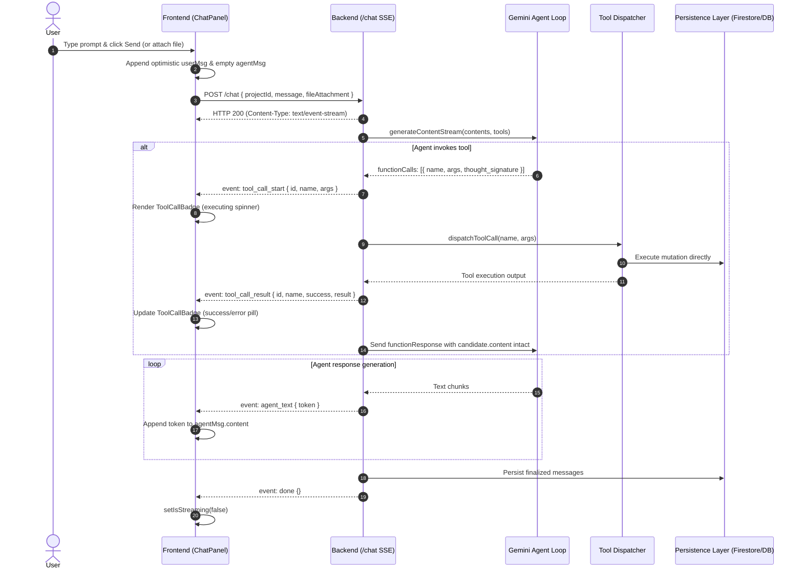

# Reusable Agent Console (30% Co-Pilot Pane) Architecture & Implementation Blueprint

This specification provides a complete reference architecture for implementing the **30% persistent, streaming agent co-pilot pane** used in the Scriptorium Talent Hub platform across new applications.

---

## 1. Architectural Overview & Design Principles

The 30% agent pane is an operational co-pilot interface designed to sit alongside a 70% workspace (e.g. document viewer, canvas, dashboard, code editor). It is engineered around four core tenets:

1. **Decoupled Asynchronous Streaming**: User inputs trigger an HTTP POST request that transitions into a Server-Sent Events (`text/event-stream`) channel. The agent streams granular telemetry (`tool_call_start`, `tool_call_result`, `agent_text`, `done`, `error`) without page reloads or blocking UI locks.
2. **Dual-State Synchronisation**:
   - **Local Optimistic Stream**: When generating, the UI renders directly from incoming SSE chunks, displaying real-time spinner animations, collapsible tool executions, and token-by-token text.
   - **Persisted Truth Sync**: When idle, the chat automatically reconciles with the persistent backend store (e.g. Firestore / PostgreSQL), preventing drift while ensuring immediate feedback during generation.
3. **Tab-Resilient In-Memory Sessions**: Agent panels remain mounted in the DOM tree using CSS visibility toggling (`hidden` when tab is inactive) rather than unmounting. In-flight streams, staged uploads, and prompt drafts survive user navigation between project tabs.
4. **First-Class Tool Transparency**: Function calls are not hidden from the user. Each tool invocation is rendered as a themed, collapsible badge (`ToolCallBadge`) displaying execution state, JSON arguments, and execution results.



---

## 2. SSE Communication Protocol & Wire Specification

The client initiates the chat via `POST /chat` with a standard JSON body, and the backend responds with a continuous `text/event-stream`.

### 2.1 Request Payload Contract

```typescript
export interface ChatRequestBody {
  projectId: string;                // Scope or workspace identifier
  message: string;                  // User prompt text
  fileUri?: string;                 // Cloud storage URI (gs:// or s3://) if a file was staged
  fileMimeType?: string;            // MIME type of the staged attachment
  contextId?: string;               // Optional contextual item ID (e.g. selected entity)
}
```

### 2.2 Wire Event Stream Schema

Each event block is framed with standard SSE lines ending in `\n\n`:

```
event: <EVENT_TYPE>
data: <JSON_STRING>

```

| Event Type | Data Payload Schema | Description |
| :--- | :--- | :--- |
| `tool_call_start` | `{ id: string, name: string, args: Record<string, unknown> }` | Emitted immediately when the LLM triggers a tool call before execution begins. |
| `tool_call_result` | `{ id: string, name: string, success: boolean, result?: unknown, error?: string }` | Emitted when tool execution finishes, including data output or error messages. |
| `agent_text` | `{ token: string }` | Emitted for each streamed textual token of the final conversational response. |
| `done` | `{}` | Emitted when the turn is fully complete and persisted. |
| `error` | `{ message: string }` | Emitted if an unhandled runtime error terminates the agent loop. |

---

## 3. Backend Agent Loop & Streaming Implementation

### 3.1 Thought Signatures & Gemini 3.x Rule
> [!CRITICAL]
> When using Gemini thinking models (e.g. `gemini-2.5-flash`, `gemini-3-flash`) with function calling, the model generates an opaque `thought_signature` on each `functionCall` part.
> In multi-turn tool loops, the preceding model `candidate.content` **must be preserved and echoed back intact** into the conversation history. Stripping or recreating the turn as a raw `{ functionCall: { name, args } }` object causes an API rejection: `400 INVALID_ARGUMENT: Function call is missing a thought_signature in functionCall parts`.

### 3.2 Reference Backend Implementation (Node.js / Express / Cloud Functions)

```typescript
import { Request, Response } from 'express';
import { GoogleGenAI } from '@google/genai';

interface ToolExecutor {
  (projectId: string, args: Record<string, any>): Promise<any>;
}

export function createChatHandler(toolsRegistry: Record<string, ToolExecutor>, toolDeclarations: any[]) {
  return async function chatHandler(req: Request, res: Response): Promise<void> {
    const { projectId, message, fileUri, fileMimeType } = req.body;

    if (!projectId || !message) {
      res.status(400).json({ error: 'Missing projectId or message' });
      return;
    }

    // 1. Establish Server-Sent Events headers
    res.setHeader('Content-Type', 'text/event-stream');
    res.setHeader('Cache-Control', 'no-cache');
    res.setHeader('Connection', 'keep-alive');
    res.flushHeaders?.();

    const sendEvent = (event: string, data: any) => {
      res.write(`event: ${event}\ndata: ${JSON.stringify(data)}\n\n`);
    };

    try {
      const ai = new GoogleGenAI({ apiKey: process.env.GEMINI_API_KEY });
      
      // 2. Build conversational contents including optional multimodal file
      const userParts: any[] = [];
      if (fileUri && fileMimeType) {
        userParts.push({
          fileData: { fileUri, mimeType: fileMimeType }
        });
      }
      userParts.push({ text: message });

      const contents: any[] = [
        // Load recent historical turns from your database here...
        { role: 'user', parts: userParts }
      ];

      let isTurnFinished = false;
      const MAX_TURNS = 6;
      let turnCount = 0;

      while (!isTurnFinished && turnCount < MAX_TURNS) {
        turnCount++;

        const response = await ai.models.generateContent({
          model: 'gemini-2.5-flash',
          contents,
          config: {
            tools: [{ functionDeclarations: toolDeclarations }],
            temperature: 0.2,
          }
        });

        const candidate = response.candidates?.[0];
        if (!candidate || !candidate.content) {
          throw new Error('LLM returned an empty response.');
        }

        // CRITICAL: Echo the full model turn back to preserve thought_signature
        contents.push(candidate.content);

        const functionCalls = candidate.content.parts?.filter(p => !!p.functionCall).map(p => p.functionCall!);

        if (functionCalls && functionCalls.length > 0) {
          const responseParts: any[] = [];

          for (const call of functionCalls) {
            const toolId = `call_${Date.now()}_${Math.random().toString(36).substring(2, 7)}`;
            const toolName = call.name;
            const toolArgs = (call.args || {}) as Record<string, any>;

            // Notify UI: Tool execution started
            sendEvent('tool_call_start', { id: toolId, name: toolName, args: toolArgs });

            let resultOutput: any;
            let success = true;
            let errorMessage: string | undefined;

            try {
              const executor = toolsRegistry[toolName];
              if (!executor) throw new Error(`Unknown tool: ${toolName}`);
              resultOutput = await executor(projectId, toolArgs);
            } catch (err: any) {
              success = false;
              errorMessage = err.message || 'Execution failed';
              resultOutput = { error: errorMessage };
            }

            // Notify UI: Tool execution completed
            sendEvent('tool_call_result', {
              id: toolId,
              name: toolName,
              success,
              result: resultOutput,
              error: errorMessage
            });

            responseParts.push({
              functionResponse: {
                name: toolName,
                response: resultOutput
              }
            });
          }

          // Supply tool responses back to the conversation
          contents.push({ role: 'tool', parts: responseParts });
        } else {
          // No more function calls: extract text and stream tokens
          isTurnFinished = true;
          const textParts = candidate.content.parts?.filter(p => !!p.text).map(p => p.text!) || [];
          const fullText = textParts.join('');

          // Stream text tokens in realistic slices
          const CHUNK_SIZE = 16;
          for (let i = 0; i < fullText.length; i += CHUNK_SIZE) {
            const token = fullText.slice(i, i + CHUNK_SIZE);
            sendEvent('agent_text', { token });
          }
        }
      }

      // 3. Persist completed conversation turns to your database here
      sendEvent('done', {});
      res.end();
    } catch (err: any) {
      sendEvent('error', { message: err.message || 'Internal agent error' });
      res.end();
    }
  };
}
```

---

## 4. Frontend Client Implementation

### 4.1 Resilient SSE Stream Consumer (`api.ts`)

Reading chunked SSE streams over `fetch` requires handling arbitrary TCP buffer splits. A single packet may contain half an event, or multiple events concatenated together.

```typescript
export interface ToolCallItem {
  id: string;
  name: string;
  args?: Record<string, unknown>;
  status: 'calling' | 'executing' | 'success' | 'error';
  result?: unknown;
  error?: string;
}

export interface ChatStreamCallbacks {
  onToolCallStart?: (tool: { id: string; name: string; args: Record<string, unknown> }) => void;
  onToolCallResult?: (result: { id: string; name: string; success: boolean; result?: unknown; error?: string }) => void;
  onTextChunk?: (chunk: string) => void;
  onDone?: () => void;
  onError?: (err: Error) => void;
}

export async function sendChatMessage(
  apiBaseUrl: string,
  projectId: string,
  message: string,
  callbacks: ChatStreamCallbacks,
  fileAttachment?: { uri: string; mimeType?: string }
): Promise<void> {
  const response = await fetch(`${apiBaseUrl}/chat`, {
    method: 'POST',
    headers: { 'Content-Type': 'application/json' },
    body: JSON.stringify({
      projectId,
      message,
      fileUri: fileAttachment?.uri,
      fileMimeType: fileAttachment?.mimeType,
    }),
  });

  if (!response.ok) {
    const errText = await response.text();
    throw new Error(`HTTP ${response.status}: ${errText}`);
  }

  if (!response.body) throw new Error('ReadableStream not supported on response.');

  const reader = response.body.getReader();
  const decoder = new TextDecoder('utf-8');
  let buffer = '';

  while (true) {
    const { done, value } = await reader.read();
    if (done) break;

    buffer += decoder.decode(value, { stream: true });
    const blocks = buffer.split('\n\n');
    buffer = blocks.pop() || ''; // Preserve incomplete trailing chunk

    for (const block of blocks) {
      if (!block.trim()) continue;

      let eventType = 'message';
      let dataStr = '';

      for (const line of block.split('\n')) {
        if (line.startsWith('event: ')) {
          eventType = line.slice(7).trim();
        } else if (line.startsWith('data: ')) {
          dataStr = line.slice(6).trim();
        }
      }

      if (!dataStr) continue;

      try {
        const payload = JSON.parse(dataStr);
        switch (eventType) {
          case 'tool_call_start':
            callbacks.onToolCallStart?.(payload);
            break;
          case 'tool_call_result':
            callbacks.onToolCallResult?.(payload);
            break;
          case 'agent_text':
            if (payload.token) callbacks.onTextChunk?.(payload.token);
            break;
          case 'done':
            callbacks.onDone?.();
            break;
          case 'error':
            callbacks.onError?.(new Error(payload.message || 'Stream error'));
            break;
        }
      } catch {
        console.warn('Failed to parse SSE JSON block:', dataStr);
      }
    }
  }
}
```

---

### 4.2 Interactive Tool Badge Component (`ToolCallBadge.tsx`)

The tool badge presents a compact status header with execution state (`Loader2`, `CheckCircle2`, `XCircle`) and an interactive disclosure widget that reveals arguments and outputs.

```tsx
import React, { useState } from 'react';
import { Wrench, CheckCircle2, XCircle, Loader2, ChevronDown } from 'lucide-react';
import { ToolCallItem } from './types';

interface ToolCallBadgeProps {
  tool: ToolCallItem;
  defaultExpanded?: boolean;
}

export const ToolCallBadge: React.FC<ToolCallBadgeProps> = ({ tool, defaultExpanded }) => {
  const isPending = tool.status === 'calling' || tool.status === 'executing';
  const isSuccess = tool.status === 'success';
  const isError = tool.status === 'error';

  // Automatically expand if currently executing or failed, unless overridden
  const [isExpanded, setIsExpanded] = useState<boolean>(
    defaultExpanded !== undefined ? defaultExpanded : (isPending || isError)
  );

  return (
    <div
      data-testid="tool-call-badge"
      className="my-2 rounded-md border border-purple-800/50 bg-[#131024] text-xs font-mono overflow-hidden shadow-sm"
    >
      {/* Header bar / Expander Trigger */}
      <div
        data-testid="tool-call-header"
        role="button"
        tabIndex={0}
        onClick={() => setIsExpanded((prev) => !prev)}
        onKeyDown={(e) => (e.key === 'Enter' || e.key === ' ') && setIsExpanded((prev) => !prev)}
        className={`flex items-center justify-between px-3 py-1.5 bg-[#201a3b] cursor-pointer select-none hover:bg-[#28214a] transition-colors ${
          isExpanded ? 'border-b border-purple-800/40' : ''
        }`}
      >
        <div className="flex items-center space-x-1.5 truncate mr-2">
          <Wrench className="w-3.5 h-3.5 text-amber-400 shrink-0" />
          <span className="font-semibold text-purple-100 truncate">Tool: {tool.name}</span>
        </div>

        <div className="flex items-center space-x-2 shrink-0">
          {isPending && (
            <span className="inline-flex items-center space-x-1 text-[11px] text-blue-400 font-sans">
              <Loader2 className="w-3 h-3 animate-spin" />
              <span>executing</span>
            </span>
          )}
          {isSuccess && (
            <span className="inline-flex items-center space-x-1 text-[11px] text-emerald-400 font-sans">
              <CheckCircle2 className="w-3 h-3" />
              <span>success</span>
            </span>
          )}
          {isError && (
            <span className="inline-flex items-center space-x-1 text-[11px] text-red-400 font-sans">
              <XCircle className="w-3 h-3" />
              <span>failed</span>
            </span>
          )}

          <button
            type="button"
            data-testid="tool-call-expander"
            aria-expanded={isExpanded}
            className="flex items-center space-x-1 text-[11px] font-sans text-purple-300 hover:text-white px-1.5 py-0.5 rounded hover:bg-purple-800/40 transition-colors"
          >
            <span className="text-[10px] uppercase tracking-wider text-purple-300/80">
              {isExpanded ? 'Hide' : 'Details'}
            </span>
            <ChevronDown
              className={`w-3.5 h-3.5 text-purple-300 transition-transform duration-200 ${
                isExpanded ? 'rotate-180' : ''
              }`}
            />
          </button>
        </div>
      </div>

      {/* Collapsible Body */}
      {isExpanded && (
        <div data-testid="tool-call-details" className="p-2.5 space-y-2 bg-[#0f0d1e]/90">
          {tool.args && (
            <div>
              <div className="text-[10px] text-purple-300/70 font-sans uppercase tracking-wider mb-0.5">
                Parameters
              </div>
              <pre className="text-[11px] text-blue-300 bg-[#181330] p-1.5 rounded border border-purple-900/50 overflow-x-auto">
                {JSON.stringify(tool.args, null, 2)}
              </pre>
            </div>
          )}

          {tool.result !== undefined && (
            <div>
              <div className="text-[10px] text-purple-300/70 font-sans uppercase tracking-wider mb-0.5">
                Result
              </div>
              <pre className="text-[11px] text-emerald-300 bg-[#181330] p-1.5 rounded border border-purple-900/50 overflow-x-auto">
                {JSON.stringify(tool.result, null, 2)}
              </pre>
            </div>
          )}

          {tool.error && (
            <div>
              <div className="text-[10px] text-red-400 font-sans uppercase tracking-wider mb-0.5">
                Error
              </div>
              <pre className="text-[11px] text-red-300 bg-red-950/40 p-1.5 rounded border border-red-800/40 overflow-x-auto">
                {tool.error}
              </pre>
            </div>
          )}
        </div>
      )}
    </div>
  );
};
```

---

### 4.3 Chat Panel Container (`ChatPanel.tsx`)

The main panel manages the dual-state lifecycle: synchronising with Firestore when idle, appending optimistic stream state when generating, managing staged attachments, and auto-scrolling.

```tsx
import React, { useState, useRef, useEffect } from 'react';
import { Send, Bot, User, Sparkles, Loader2, AlertCircle, Paperclip, FileText, X } from 'lucide-react';
import { ToolCallBadge } from './ToolCallBadge';
import { sendChatMessage } from './api';

export interface ChatMessage {
  id: string;
  sender: 'user' | 'agent';
  content: string;
  toolCalls?: any[];
  fileAttachment?: { uri: string; filename: string; mimeType: string };
  timestamp: string;
}

interface ChatPanelProps {
  projectId: string;
  persistedMessages: ChatMessage[];
  title?: string;
  apiBaseUrl: string;
  onFileUpload: (file: File) => Promise<{ uri: string }>;
  promptStarters?: string[];
}

export const ChatPanel: React.FC<ChatPanelProps> = ({
  projectId,
  persistedMessages,
  title = 'Supervisor Agent',
  apiBaseUrl,
  onFileUpload,
  promptStarters = [
    'Change status to completed and add tag "reviewed"',
    'List all pending tasks and summarize risks'
  ]
}) => {
  const [messages, setMessages] = useState<ChatMessage[]>(persistedMessages);
  const [inputText, setInputText] = useState('');
  const [isStreaming, setIsStreaming] = useState(false);
  const [statusTicker, setStatusTicker] = useState<string | null>(null);
  const [errorText, setErrorText] = useState<string | null>(null);
  const [stagedFile, setStagedFile] = useState<{ file: File; uri?: string; uploading: boolean } | null>(null);

  const scrollRef = useRef<HTMLDivElement>(null);
  const fileInputRef = useRef<HTMLInputElement>(null);

  // Reconcile with persisted storage only when idle
  useEffect(() => {
    if (!isStreaming) {
      setMessages(persistedMessages);
    }
  }, [persistedMessages, isStreaming]);

  // Keep scrolled to bottom
  useEffect(() => {
    if (scrollRef.current) {
      scrollRef.current.scrollTop = scrollRef.current.scrollHeight;
    }
  }, [messages, statusTicker, isStreaming]);

  const handleFileChange = async (e: React.ChangeEvent<HTMLInputElement>) => {
    const file = e.target.files?.[0];
    if (!file) return;

    setStagedFile({ file, uploading: true });
    try {
      const res = await onFileUpload(file);
      setStagedFile({ file, uri: res.uri, uploading: false });
    } catch (err: any) {
      setErrorText(err.message || 'File upload failed');
      setStagedFile(null);
    }
  };

  const handleSubmit = async (e: React.FormEvent) => {
    e.preventDefault();
    const prompt = inputText.trim();
    if (!prompt || isStreaming) return;
    if (stagedFile?.uploading) {
      setErrorText('Please wait for file upload to finish.');
      return;
    }

    const filePayload = stagedFile?.uri ? {
      uri: stagedFile.uri,
      filename: stagedFile.file.name,
      mimeType: stagedFile.file.type || 'application/octet-stream'
    } : undefined;

    setStagedFile(null);
    if (fileInputRef.current) fileInputRef.current.value = '';
    setInputText('');
    setErrorText(null);
    setIsStreaming(true);
    setStatusTicker('Thinking...');

    const userTurn: ChatMessage = {
      id: `local-user-${Date.now()}`,
      sender: 'user',
      content: prompt,
      fileAttachment: filePayload,
      timestamp: new Date().toISOString(),
    };

    const agentTurn: ChatMessage = {
      id: `local-agent-${Date.now()}`,
      sender: 'agent',
      content: '',
      toolCalls: [],
      timestamp: new Date().toISOString(),
    };

    setMessages((prev) => [...prev, userTurn, agentTurn]);

    try {
      await sendChatMessage(
        apiBaseUrl,
        projectId,
        prompt,
        {
          onToolCallStart: (tool) => {
            setStatusTicker(`Executing tool: ${tool.name}...`);
            setMessages((prev) => {
              const last = { ...prev[prev.length - 1] };
              last.toolCalls = [
                ...(last.toolCalls || []),
                { id: tool.id, name: tool.name, args: tool.args, status: 'executing' }
              ];
              return [...prev.slice(0, -1), last];
            });
          },
          onToolCallResult: (res) => {
            setStatusTicker(`Tool ${res.name} finished`);
            setMessages((prev) => {
              const last = { ...prev[prev.length - 1] };
              last.toolCalls = (last.toolCalls || []).map((t) =>
                t.id === res.id || t.name === res.name
                  ? { ...t, status: res.success ? 'success' : 'error', result: res.result, error: res.error }
                  : t
              );
              return [...prev.slice(0, -1), last];
            });
          },
          onTextChunk: (chunk) => {
            setStatusTicker(null);
            setMessages((prev) => {
              const last = { ...prev[prev.length - 1] };
              last.content = (last.content || '') + chunk;
              return [...prev.slice(0, -1), last];
            });
          },
          onDone: () => {
            setIsStreaming(false);
            setStatusTicker(null);
          },
          onError: (err) => {
            setIsStreaming(false);
            setStatusTicker(null);
            setErrorText(err.message);
          }
        },
        filePayload
      );
    } catch (err: any) {
      setIsStreaming(false);
      setStatusTicker(null);
      setErrorText(err.message || 'Connection failed');
    }
  };

  return (
    <div
      data-testid="chat-window"
      className="w-full md:w-[32%] lg:w-[30%] h-full flex flex-col bg-[#161b22] select-none border-l border-[#30363d]"
    >
      {/* Pane Header */}
      <div className="h-10 border-b border-[#30363d] px-4 flex items-center justify-between bg-[#161b22]">
        <div className="flex items-center space-x-2">
          <Sparkles className="w-4 h-4 text-purple-400" />
          <span className="text-xs font-semibold text-gray-300 tracking-wide uppercase">
            {title}
          </span>
        </div>
      </div>

      {/* Message List */}
      <div ref={scrollRef} className="flex-1 p-4 overflow-y-auto space-y-4 font-sans select-text">
        {messages.length === 0 ? (
          <div className="h-full flex flex-col items-center justify-center text-center p-6 text-gray-500 space-y-3">
            <Bot className="w-10 h-10 text-gray-600 mb-1" />
            <p className="text-sm font-medium text-gray-400">{title} Ready</p>
            <p className="text-xs text-gray-500 max-w-xs">
              Instruct the agent to inspect records, trigger actions, or update state:
            </p>
            <div className="space-y-1.5 text-xs text-blue-400 text-left w-full mt-2">
              {promptStarters.map((starter, idx) => (
                <button
                  key={idx}
                  onClick={() => setInputText(starter)}
                  className="w-full text-left p-2 rounded bg-[#0d1117] hover:bg-[#21262d] border border-[#30363d] transition-colors"
                >
                  &quot;{starter}&quot;
                </button>
              ))}
            </div>
          </div>
        ) : (
          messages.map((msg) => (
            <div
              key={msg.id}
              className={`flex flex-col ${msg.sender === 'user' ? 'items-end' : 'items-start'}`}
            >
              <div className="flex items-center space-x-1.5 text-[11px] text-gray-400 mb-1 px-1">
                {msg.sender === 'user' ? (
                  <>
                    <span className="font-semibold text-blue-300">User</span>
                    <User className="w-3 h-3 text-blue-400" />
                  </>
                ) : (
                  <>
                    <Bot className="w-3 h-3 text-purple-400" />
                    <span className="font-semibold text-purple-300">Agent</span>
                  </>
                )}
              </div>

              <div
                className={`max-w-[90%] rounded-lg px-3.5 py-2.5 text-xs leading-relaxed ${
                  msg.sender === 'user'
                    ? 'bg-blue-600 text-white shadow-sm'
                    : 'bg-[#1c1836] text-gray-100 border border-purple-500/30 shadow-sm w-full'
                }`}
              >
                {/* File Attachment Pill */}
                {msg.fileAttachment && (
                  <div className="mb-2 flex items-center space-x-1.5 bg-black/20 px-2 py-1 rounded text-[11px] border border-white/10">
                    <FileText className="w-3.5 h-3.5 text-blue-300 shrink-0" />
                    <span className="truncate">{msg.fileAttachment.filename}</span>
                  </div>
                )}

                {/* Collapsible Tool Call Badges */}
                {msg.toolCalls && msg.toolCalls.length > 0 && (
                  <div className="space-y-1 mb-2">
                    {msg.toolCalls.map((tool, idx) => (
                      <ToolCallBadge key={tool.id || idx} tool={tool} />
                    ))}
                  </div>
                )}

                {/* Message Content */}
                <div className="whitespace-pre-wrap">{msg.content}</div>
              </div>
            </div>
          ))
        )}
      </div>

      {/* Floating Status Ticker */}
      {statusTicker && (
        <div className="px-4 py-1.5 bg-[#1f1b38] border-t border-purple-900/40 flex items-center space-x-2 text-[11px] text-purple-300 animate-pulse">
          <Loader2 className="w-3 h-3 animate-spin text-purple-400" />
          <span>{statusTicker}</span>
        </div>
      )}

      {/* Error Banner */}
      {errorText && (
        <div className="px-4 py-1.5 bg-red-950/60 border-t border-red-800/50 flex items-center space-x-2 text-[11px] text-red-300">
          <AlertCircle className="w-3.5 h-3.5 shrink-0" />
          <span className="truncate">{errorText}</span>
          <button onClick={() => setErrorText(null)} className="ml-auto text-red-400 hover:text-white">
            <X className="w-3 h-3" />
          </button>
        </div>
      )}

      {/* Staged File Upload Pill */}
      {stagedFile && (
        <div className="px-3 py-1 bg-[#1c2128] border-t border-[#30363d] flex items-center justify-between text-xs text-gray-300">
          <div className="flex items-center space-x-2 truncate">
            {stagedFile.uploading ? (
              <Loader2 className="w-3.5 h-3.5 animate-spin text-blue-400 shrink-0" />
            ) : (
              <FileText className="w-3.5 h-3.5 text-emerald-400 shrink-0" />
            )}
            <span className="truncate">{stagedFile.file.name}</span>
          </div>
          <button
            onClick={() => setStagedFile(null)}
            className="text-gray-400 hover:text-white p-0.5"
            disabled={stagedFile.uploading}
          >
            <X className="w-3.5 h-3.5" />
          </button>
        </div>
      )}

      {/* Input Bar */}
      <form onSubmit={handleSubmit} className="p-3 border-t border-[#30363d] bg-[#161b22] flex items-center space-x-2">
        <input
          ref={fileInputRef}
          type="file"
          className="hidden"
          onChange={handleFileChange}
          accept=".pdf,.txt,.md,.json,.csv,.doc,.docx"
        />
        <button
          type="button"
          onClick={() => fileInputRef.current?.click()}
          disabled={isStreaming}
          className="p-2 rounded text-gray-400 hover:text-gray-200 hover:bg-[#21262d] transition-colors disabled:opacity-50"
          title="Attach document"
        >
          <Paperclip className="w-4 h-4" />
        </button>

        <input
          type="text"
          value={inputText}
          onChange={(e) => setInputText(e.target.value)}
          placeholder="Command the agent..."
          disabled={isStreaming}
          className="flex-1 bg-[#0d1117] border border-[#30363d] rounded px-3 py-1.5 text-xs text-gray-200 focus:outline-none focus:border-purple-500 placeholder-gray-500 disabled:opacity-50"
        />

        <button
          type="submit"
          disabled={isStreaming || !inputText.trim()}
          className="p-2 rounded bg-purple-600 hover:bg-purple-500 text-white transition-colors disabled:opacity-40 disabled:hover:bg-purple-600"
        >
          {isStreaming ? <Loader2 className="w-4 h-4 animate-spin" /> : <Send className="w-4 h-4" />}
        </button>
      </form>
    </div>
  );
};
```

---

### 4.4 Tab Navigation Preservation Pattern

To maintain continuous SSE connections and form drafts when the user navigates between projects, wrap sessions inside an in-memory parent container using the CSS `hidden` attribute:

```tsx
export const WorkspaceLayout: React.FC = () => {
  const [activeTabId, setActiveTabId] = useState('project-1');
  const openTabs = ['project-1', 'project-2'];

  return (
    <div className="flex h-screen w-screen overflow-hidden bg-[#0d1117]">
      {openTabs.map((tabId) => (
        <div
          key={tabId}
          className={`flex w-full h-full ${activeTabId === tabId ? 'flex' : 'hidden'}`}
        >
          {/* 70% Main Workspace Pane */}
          <main className="w-full md:w-[68%] lg:w-[70%] h-full overflow-y-auto">
            <MainWorkspaceView projectId={tabId} />
          </main>

          {/* 30% Agent Co-Pilot Pane */}
          <ChatPanel
            projectId={tabId}
            apiBaseUrl="/api"
            persistedMessages={[]}
            onFileUpload={async (file) => ({ uri: `gs://bucket/uploads/${file.name}` })}
          />
        </div>
      ))}
    </div>
  );
};
```

---

## 5. Visual Styling & Color Tokens Reference

The design system uses a dark palette inspired by GitHub Dark with purple agent accents:

| Token / Role | Tailwind Class / Hex | Usage |
| :--- | :--- | :--- |
| **Panel Background** | `bg-[#161b22]` | Chat container and header |
| **Input / Outer Background** | `bg-[#0d1117]` | Workspace background, message inputs |
| **Borders** | `border-[#30363d]` | Dividing lines, header borders, inputs |
| **User Message Bubble** | `bg-blue-600 text-white` | Supervisor/User speech bubble |
| **Agent Message Bubble** | `bg-[#1c1836] border border-purple-500/30` | Agent speech bubble |
| **Tool Badge Container** | `bg-[#131024] border-purple-800/50` | Outer box for tool invocation |
| **Tool Badge Header** | `bg-[#201a3b] hover:bg-[#28214a]` | Clickable tool accordion trigger |
| **Tool Code Block** | `bg-[#181330] border-purple-900/50` | JSON parameters and output dumps |
| **Status Pills** | `text-blue-400` / `text-emerald-400` / `text-red-400` | Executing / Success / Failed states |

---

## 6. Implementation Checklist for New Projects

- [ ] **Backend SSE Endpoint**: Configure `text/event-stream` with buffer flushing on your server framework.
- [ ] **Thought Signature Preservation**: Ensure Gemini's `candidate.content` is returned verbatim to the history array during tool loops.
- [ ] **Tool Declaration Schema**: Ensure domain-specific tool descriptions contain business intent, trigger phrases, and negative guardrails.
- [ ] **Direct SDK Mutations**: Have server-side tools mutate your datastore directly rather than sending state over the SSE wire.
- [ ] **Client SSE Parser**: Implement line buffer accumulation (`buffer.split('\n\n')`) to prevent TCP chunk truncation.
- [ ] **Dual-State Sync**: Sync with persistent database messages only when `isStreaming === false`.
- [ ] **DOM Visibility Caching**: Retain unselected tabs with CSS `hidden` so background SSE streaming and drafts persist.
- [ ] **Collapsible Badges**: Provide `<ToolCallBadge />` with expandable JSON views for full operational transparency.
